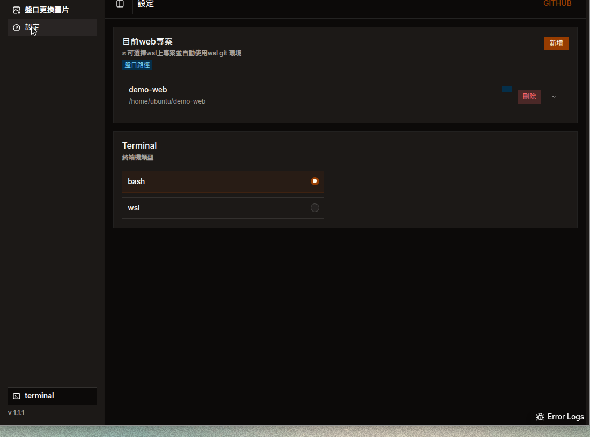
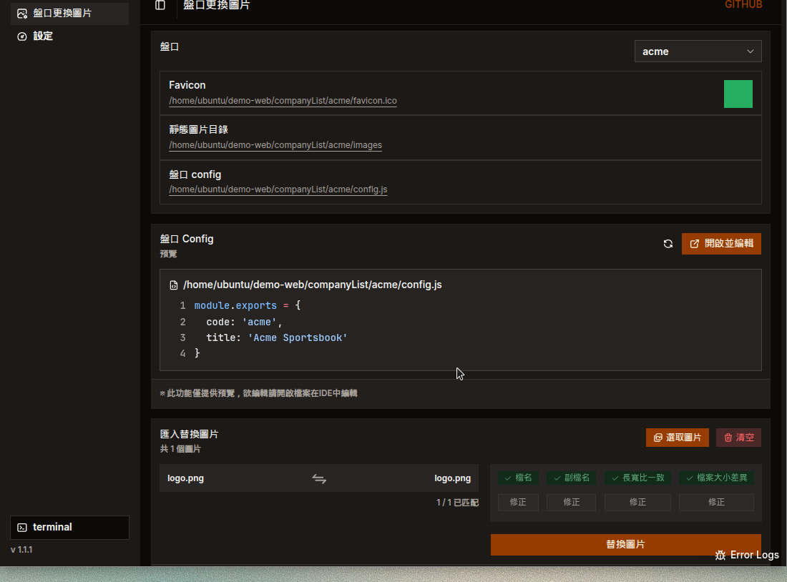
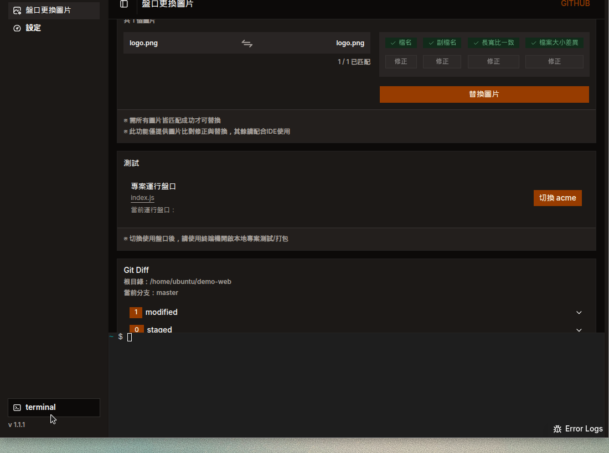
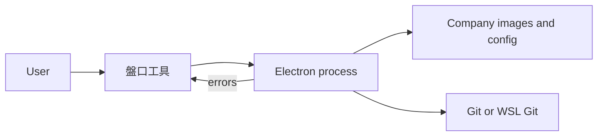

# 盤口工具

[English](README.md) · [中文](README.zh-TW.md)

## Purpose

盤口工具 is a Windows desktop app for swapping images in a company web project. It matches new files to the images already in a company folder, fixes the name, format, or size when needed, and copies them into place. Commit, and running or building that project, stay in your editor.

## Features

### Add a project

Open 設定 and click 新增. Choose the web project folder. The app keeps the project and looks for `companyList` and a project config file (`multipage.project*` or `index*`). A blue mark means `companyList` was found. Only those projects can be selected on the image page.

On the same page, Terminal chooses `bash` or `wsl`. A project opened from a WSL path uses that distro's Git.



### Choose a company folder

Open 盤口更換圖片, select the project, then select a company folder. The page lists the favicon, the static image directory, and the company config. The config preview is read-only. 開啟並編輯 opens that file for you to change in an editor.



### Import, check, and replace images

Click 選取圖片 and choose the new files. Each file is matched to an existing image by name. The checks are filename, extension, aspect ratio, and whether the new file is within 50% of the old file's size. 修正 renames, converts, or compresses when that check failed. Aspect ratio has no automatic fix.

替換圖片 stays off until every imported file has a match. Replace only copies the files. It does not commit, and it does not start or build the web project.

The screenshot above shows `logo.png` matched `1/1`, with all four checks passing and 替換圖片 available.

### Switch the company the project runs

The 測試 card shows the project config and the company that is active now. 切換 updates that config so the selected company is the one in use. Afterward, start or build the project from the terminal or your editor. This app does not do that for you.

Switching only works when that config has exactly one active declaration and exactly one commented declaration for the company, and the file exports a variable with `module.exports` or `export default`.


### Review the Git diff

Git Diff shows the repo root, the current branch, and how many files are modified, staged, added, deleted, renamed, or in conflict. Open a changed image to compare the new file with the copy from Git. The card is a preview of size and dimensions. It does not commit.

The same screenshot shows one modified file after `logo.png` was replaced.

### Use the terminal

The terminal button at the bottom of the sidebar opens a shell in the app. It uses the type selected in 設定. On Windows, `wsl` starts `wsl.exe`. The shell is for running the web project yourself after a switch or a replace.



## Getting started

Download the Windows installer from the [latest release](https://github.com/ZiJson/changeImgGUI/releases/latest). The current file is [changeimggui-1.1.1-setup.exe](https://github.com/ZiJson/changeImgGUI/releases/download/v1.1.1/changeimggui-1.1.1-setup.exe).

Run `setup.exe`. The installer adds a desktop shortcut named 盤口工具. Open the app from that shortcut. You do not start it from a terminal.

This installer was not run in the session that captured the screenshots above. Those screenshots are from the same app, version 1.1.1.

To change this app itself: `pnpm install`, then `pnpm dev`. `pnpm release:win` publishes a new `setup.exe` and needs `GH_TOKEN` or `GITHUB_TOKEN`.

## Architecture

The window is the React UI. Actions go to the Electron process, which updates the project files and reads Git. Errors from that work are listed in Error Logs.



## Repository structure

```text
src/main/        Electron process that edits files and reads Git
src/preload/     Bridge the window uses
src/renderer/    React UI, including 盤口更換圖片 and 設定
src/shared/      Types shared by the UI and the Electron process
docs/assets/     Screenshots used above
```
