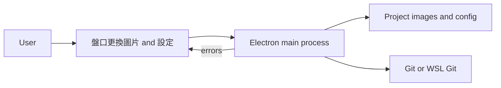
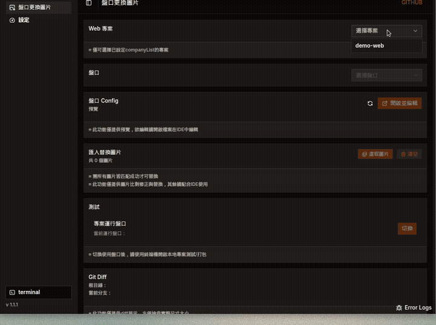

# 盤口工具

[English](README.md) · [中文](README.zh-TW.md)

## Purpose

盤口工具 replaces images in a company web project. You pick the project and a company folder, import the new pictures, fix the name, format, or file size when they do not match, and copy them over the existing files. Commit, dev, and build stay in your editor.

## Features

- Save a web project. The app finds `companyList` and a project config file when they are already in the repo.
- Choose a company folder and preview its config, favicon, and image directory.
- Import replacement images and match them by filename, extension, aspect ratio, and file size.
- Rename, convert, or compress a file when one of those checks fails.
- Replace the matched images in the project. Every imported image must match before replace is enabled.
- Show the Git branch and a diff of the changed images. A `\\wsl$\` or `\\wsl.localhost\` project uses that distro's Git.
- Open a terminal, and show main-process errors in Error Logs.

## Usage

Requires Node.js 22 and pnpm.

```bash
pnpm install
pnpm dev
```

1. Open 設定 and add the web project. Only a project that has `companyList` can be used on the image page.
2. Open 盤口更換圖片 and select that project.
3. Select the company folder.
4. Choose the replacement images.
5. Fix any failed check, then click 替換圖片.
6. Review the Git diff in the app, then commit from your editor.

`pnpm typecheck` and `pnpm lint` check the app. `pnpm build:win` builds the Windows installer. `pnpm release:win` publishes that installer and needs `GH_TOKEN` or `GITHUB_TOKEN`.

## Architecture

The window is a React app. Buttons call the Electron main process, which reads and writes the project files and asks Git for status. Failures from that work show up in Error Logs.



## Repository structure

```text
src/main/        Electron process that edits files and reads Git
src/preload/     Bridge the window uses to call that process
src/renderer/    React UI, including 盤口更換圖片 and 設定
src/shared/      Types shared by the UI and the Electron process
docs/assets/     Demo GIFs
```

## Demo

The clip selects a saved project, selects the company folder `acme`, imports `logo.png`, and reaches 替換圖片 after `1/1` matched. The file in the project was replaced with the imported image.


