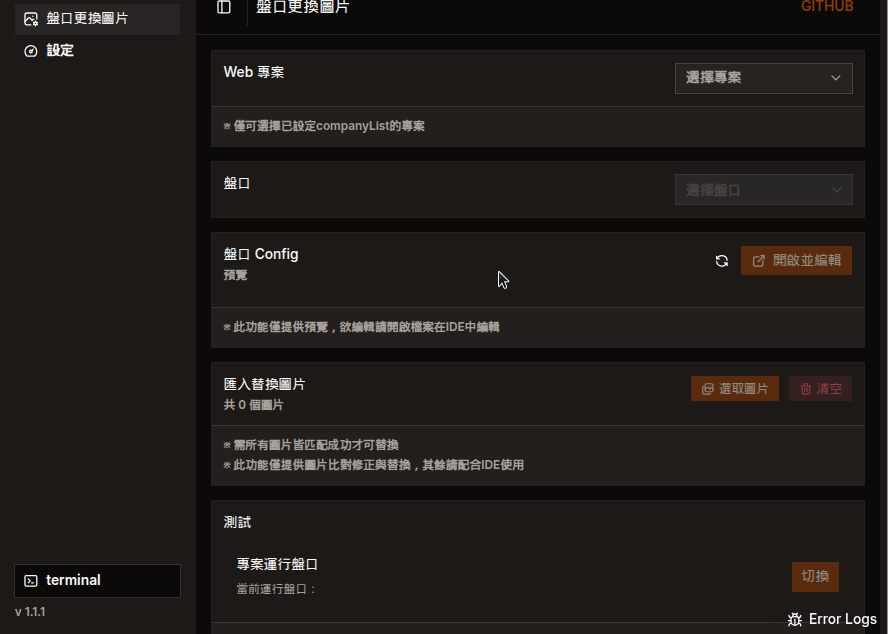
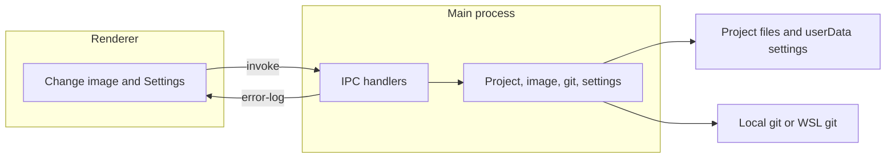

# 盤口工具

Desktop tool for replacing images in a company web project. It renames, converts, and compresses incoming files, copies them over the matching images, and previews the Git diff. It does not commit, and it does not run the target project's dev server or build.

The window title and in-app copy are Traditional Chinese. The npm package name is `changeimggui` (version 1.1.1).



## Table of Contents

- [Project Overview](#project-overview)
- [Architecture](#architecture)
- [Repository Structure](#repository-structure)
- [Dependencies and Integration](#dependencies-and-integration)
- [API Documentation](#api-documentation)
- [Development Notes](#development-notes)
- [Known Issues and Limitations](#known-issues-and-limitations)
- [Additional Documentation](#additional-documentation)
- [操作方式](#操作方式)

## Project Overview

Use this app when a company site needs a new set of images and the filenames, formats, or file sizes have to match what is already in the repo.

What it does:

- Stores web projects and, when present, finds `companyList` plus a project config file (`multipage.project*` or `index*`).
- Lists company folders and previews `config.js` or `index.js`, the favicon, and the static image directory.
- Imports replacement images, matches them to existing files, and can rename, convert, or compress before replacing.
- Shows the current Git status and a side-by-side size and dimension diff. On Windows, a `\\wsl$\` or `\\wsl.localhost\` project path uses that distro's `git`.
- Can switch the active company by commenting and uncommenting one exported declaration in the project config.
- Opens an embedded terminal (`bash`, or `wsl` when selected in Settings).
- Shows main-process failures in the Error Logs drawer.

A project can be saved before `companyList` or the config file exists. The image page only offers projects that already have `companyList`.

## Architecture

Electron splits the UI from filesystem and Git work. The renderer talks to the main process through a preload bridge. Each IPC handler reports thrown service errors on the `error-log` channel, then rethrows so the caller still fails.



Stack: Electron 44, electron-vite, React 19, TypeScript, Vite, Tailwind CSS 4, TanStack Query, and Zustand. Image work uses `sharp`. Git status uses `simple-git`, or `wsl.exe` when the project path is a WSL UNC path.

## Repository Structure

```text
src/main/            Electron main process, IPC, and services
src/preload/         contextBridge API used by the renderer
src/renderer/src/    React UI. page/ChangeImg and page/Settings are the live routes
src/shared/          IPC channel names and shared types
scripts/release-win.mjs
electron.vite.config.ts
electron-builder.yml
```

`/` redirects to `/changeImg`. The home route in `src/renderer/src/route.tsx` is commented out.

## Dependencies and Integration

This app does not call a backend service of its own.

| Integration | Role |
| --- | --- |
| Git on the project path | Status and `git show HEAD:<file>` for the image diff. WSL paths shell out to `wsl.exe`. |
| GitHub Releases | Packaged builds check for updates with `electron-updater` (`owner` `ZiJson`, repo `changeImgGUI`). Dev runs skip that check. |

Settings are a JSON file under Electron `userData`. Replacement images are copied into a temp directory before they are edited.

## API Documentation

The renderer API is IPC, defined in `src/shared/ipc.ts`. There is no HTTP API. Arguments and return values below match `IpcInvokeMap`.

| Channel | Arguments | Returns |
| --- | --- | --- |
| `select-directory` | optional default path | selected directory, or `null` |
| `select-images` | optional default path | temp paths, or `null` |
| `select-file` | optional default path | selected file, or `null` |
| `open-external` | URL | `void` |
| `reveal-in-file-explorer` | path, optional `select` or `open` | `true` |
| `project:add-new-project` | `ProjectInfo` | `void` |
| `project:update-project` | `ProjectInfo` | `void` |
| `project:delete-project` | `ProjectInfo` | `void` |
| `project:get-projects` | none | `ProjectInfo[]` |
| `project:get-company-folder-list` | `ProjectInfo` | `CompanyFolder[]` |
| `project:get-fav-icon-by-company-folder` | `CompanyFolder` | favicon path, or `""` |
| `project:get-image-folder-by-company-folder` | `CompanyFolder` | image directory, or `""` |
| `project:switch-company-config` | config path, company code | `void` |
| `project:get-active-company-code` | config path, company codes | active code, or `null` |
| `project:get-company-config-by-company-folder` | `CompanyFolder` | `{ path, content }` |
| `image:check-images-match` | company folder and new paths | match results and summary |
| `image:fix-image-file-names` | image pairs | renamed pairs |
| `image:compress-images` | image pairs | same pairs |
| `image:convert-images` | image pairs | converted pairs |
| `image:replace-images` | image pairs | same pairs |
| `git:get-git-status` | project path | branch and file lists |
| `git:get-git-image-paths` | project path, relative path | current and previous image info |
| `git:get-git-repo-info` | project path | repo root |
| `create-terminal` | none | `boolean` |
| `dispose-terminal` | none | `void` |
| `terminal-settings` | none | `{ options, selected }` |
| `terminal-settings-update` | terminal config | `void` |

Main-to-renderer events: `terminal-output` (string data) and `error-log` (`ErrorLog`). The renderer sends `terminal-input`.

Image checks compare the filename without extension, the extension, the aspect ratio, and whether the new file is at most 50% larger than the old one. `.ico` files are matched to `favicon.ico` and skip the Sharp metadata checks. Every matched image must pass before replace is allowed.

## Development Notes

Requires Node.js 22 and pnpm. This repo was started with Node.js 22.23 and pnpm 10.

```bash
pnpm install
pnpm dev
```

`pnpm dev` opens the Electron window and serves the renderer (port 5173 when it is free).

| Command | What it does |
| --- | --- |
| `pnpm typecheck` | `tsc` for the main and renderer projects |
| `pnpm lint` | ESLint |
| `pnpm build` | typecheck, then `electron-vite build` |
| `pnpm start` | `electron-vite preview` of a build |
| `pnpm build:win` | Windows NSIS installer |
| `pnpm build:mac` / `pnpm build:linux` | platform packages |
| `pnpm release:win` | build the Windows installer and upload one complete GitHub release |

`pnpm release:win` needs `GH_TOKEN` or `GITHUB_TOKEN` with repo permission. `pnpm publish:win` is the same script with `--retry`.

There is no automated test suite. Service failures throw an English `Error` whose `message` is what Error Logs shows.

## Known Issues and Limitations

- Replacing images only copies files. Commit, dev, and build stay in the editor you already use.
- Switching company config requires exactly one active declaration and exactly one commented declaration for that company code. The file must export a variable via `module.exports` or `export default`.
- The home page route is commented out.
- A packaged app checks GitHub for updates. `pnpm dev` does not.
- On Linux, `sharp` can warn that Electron's binaries may be incompatible. The app still starts.
- `electron-builder.yml` still has the electron-builder sample maintainer string `electronjs.org`.

## Additional Documentation

- [AGENTS.md](AGENTS.md) — how Cloud Agents should treat company project layouts.

## 操作方式

The screenshots below are the existing in-app walkthrough: pick a project, pick a company folder, import images, fix name / format / size, replace, then confirm the diff.

1. Select a project.


2. Select a company folder.


3. Import replacement images.


4. Fix filename, format, or compression.


5. Replace the images in the project.


6. Confirm size and dimension differences in the diff.


Settings is where a project and its `companyList` path are chosen. A WSL project path is supported when that is how the repo is normally developed.
