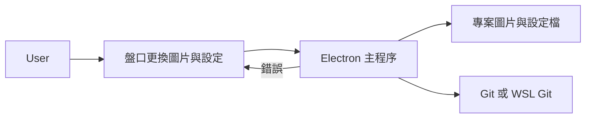

# 盤口工具

[English](README.md) · [中文](README.zh-TW.md)

## 用途

盤口工具用來替換公司 web 專案裡的圖片。選好專案和盤口後，匯入新圖，必要時修正檔名、格式或檔案大小，再覆蓋專案裡的舊圖。Commit、啟動開發伺服器與打包仍在你平常的編輯器裡做。

## 功能

- 儲存 web 專案。專案裡已有 `companyList` 和專案設定檔時，會一併找到。
- 選擇盤口，並預覽該盤口的 config、favicon 與圖片目錄。
- 匯入替換圖片，並比對檔名、副檔名、長寬比與檔案大小。
- 某一項比對失敗時，可重新命名、轉檔或壓縮。
- 替換專案內已匹配的圖片。全部圖片都匹配後才能替換。
- 顯示 Git 分支與變更圖片的 diff。`\\wsl$\` 或 `\\wsl.localhost\` 路徑會使用該發行版的 Git。
- 可開啟終端機。主程序的錯誤會出現在 Error Logs。

## 使用方式

需要 Node.js 22 與 pnpm。

```bash
pnpm install
pnpm dev
```

1. 打開設定，新增 web 專案。圖片頁只能選擇已有 `companyList` 的專案。
2. 打開盤口更換圖片，選擇該專案。
3. 選擇盤口。
4. 選取要替換的圖片。
5. 修正失敗的檢查後，按替換圖片。
6. 在應用裡看 Git diff，再到編輯器提交。

`pnpm typecheck` 與 `pnpm lint` 用來檢查這個應用。`pnpm build:win` 會做出 Windows 安裝檔。`pnpm release:win` 會發布該安裝檔，需要 `GH_TOKEN` 或 `GITHUB_TOKEN`。

## 架構

視窗是 React。按鈕會呼叫 Electron 主程序，由它讀寫專案檔案並向 Git 查狀態。這段工作的失敗會顯示在 Error Logs。



## 專案結構

```text
src/main/        負責改檔與讀取 Git 的 Electron 程序
src/preload/     視窗用來呼叫該程序的橋
src/renderer/    React 介面，包含盤口更換圖片與設定
src/shared/      介面與 Electron 程序共用的型別
docs/assets/     示範 GIF
```

## 示範

影片選取已儲存的專案與盤口 `acme`，匯入 `logo.png`，在 `1/1` 已匹配後到達替換圖片。專案裡的檔案已換成匯入的圖片。


