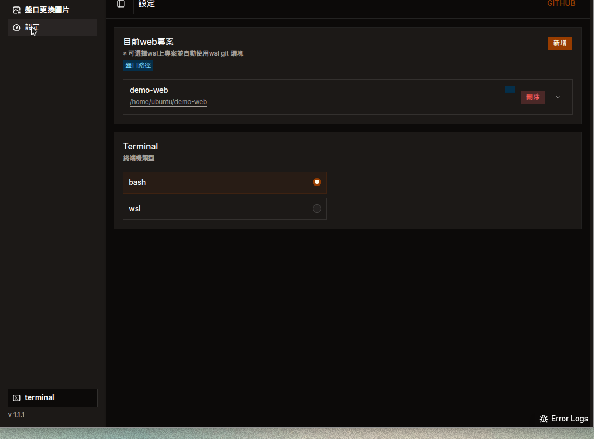
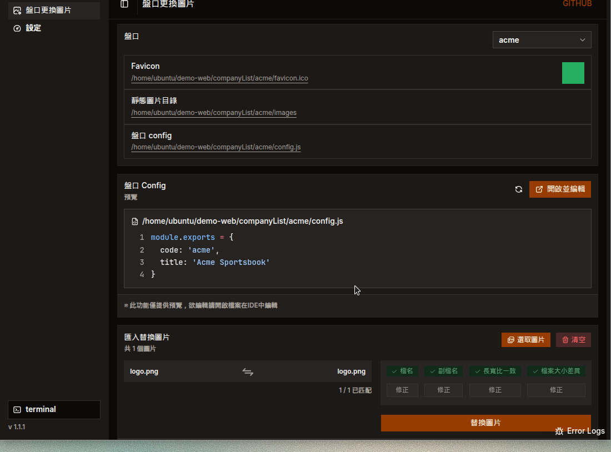
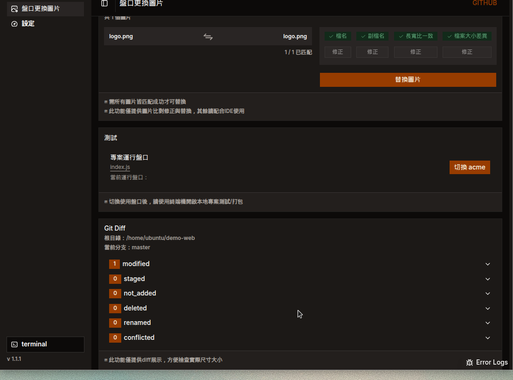
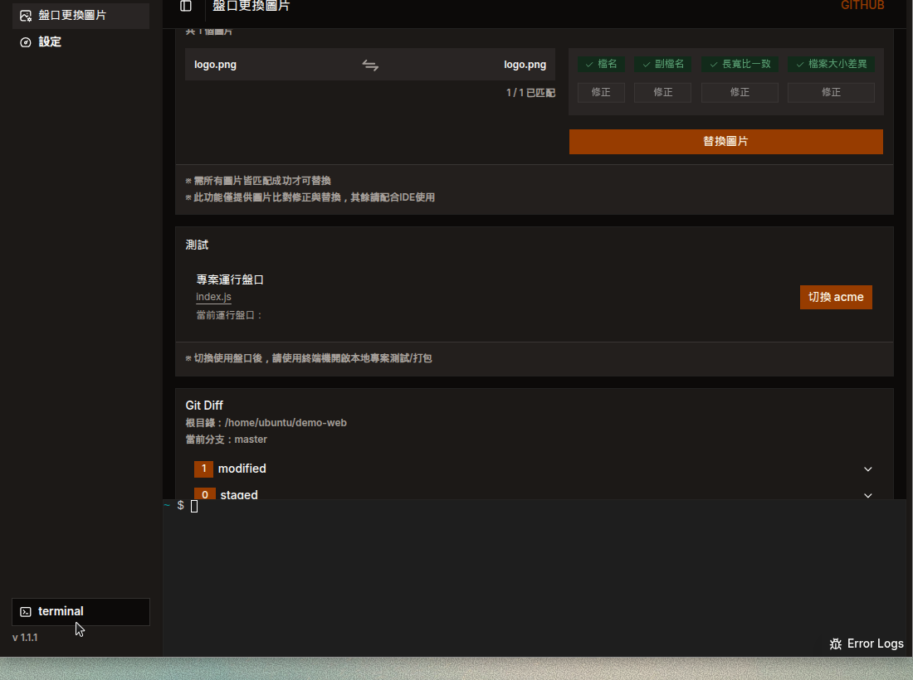
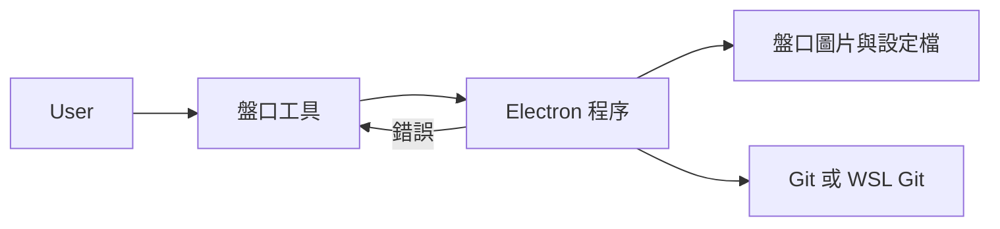

# 盤口工具

[English](README.md) · [中文](README.zh-TW.md)

## 用途

盤口工具是 Windows 桌面程式，用來替換公司 web 專案裡的圖片。它把新圖對上盤口裡現有的圖，必要時修正檔名、格式或大小，再複製進去。Commit，以及啟動或打包那個專案，仍在你的編輯器裡做。

## 功能

### 新增專案

打開設定，按新增，選 web 專案資料夾。程式會記住這個專案，並尋找 `companyList` 與專案設定檔（`multipage.project*` 或 `index*`）。有藍色標記代表已找到 `companyList`。只有這種專案能在換圖頁被選到。

同一頁的 Terminal 可選 `bash` 或 `wsl`。從 WSL 路徑打開的專案會使用該發行版的 Git。



### 選擇盤口

打開盤口更換圖片，先選專案，再選盤口。頁面會列出 favicon、靜態圖片目錄和盤口 config。Config 預覽不能在這裡改。開啟並編輯會打開該檔，讓你在編輯器裡修改。



### 匯入、比對並替換圖片

按選取圖片，選新的檔案。每個檔會依名稱對上既有圖片。檢查項目是檔名、副檔名、長寬比，以及新檔大小是否在舊檔的 50% 以內。某一項失敗時，修正會重新命名、轉檔或壓縮。長寬比沒有自動修正。

全部匯入的圖都匹配後，替換圖片才會亮起。替換只複製檔案，不會 commit，也不會啟動或打包 web 專案。

上一張圖裡，`logo.png` 為 `1/1` 已匹配，四項檢查都通過，替換圖片可以按。

### 切換專案使用的盤口

測試卡片顯示專案設定檔，以及目前啟用的盤口。切換會改寫該設定，讓選中的盤口變成正在使用的那個。之後請用終端機或編輯器啟動、打包專案。這個程式不會代勞。

切換只在設定檔裡恰好有一個啟用中的宣告、以及該盤口恰好有一個被註解的宣告時可用。檔案必須用 `module.exports` 或 `export default` 匯出變數。



### 查看 Git diff

Git Diff 顯示專案根目錄、目前分支，以及 modified、staged、added、deleted、renamed、conflicted 的數量。打開變更的圖片可對照 Git 裡的舊檔，用來確認尺寸。這裡只供預覽，不會 commit。

同一張圖顯示替換 `logo.png` 之後有 1 個 modified。

### 使用終端機

側欄底部的 terminal 會在程式裡打開 shell，類型沿用設定裡的選擇。在 Windows 上，`wsl` 會啟動 `wsl.exe`。換圖或切換盤口之後，用這個 shell 自己啟動 web 專案。



## 啟動方式

從[最新的 Release](https://github.com/ZiJson/changeImgGUI/releases/latest) 下載 Windows 安裝檔。目前的檔案是 [changeimggui-1.1.1-setup.exe](https://github.com/ZiJson/changeImgGUI/releases/download/v1.1.1/changeimggui-1.1.1-setup.exe)。

執行 `setup.exe`。安裝程式會在桌面建立名為盤口工具的捷徑。從捷徑開啟，不要從終端機啟動。

截圖那次沒有執行這個安裝檔。畫面來自同一個 1.1.1 程式。

若要改這個程式本身：`pnpm install`，然後 `pnpm dev`。`pnpm release:win` 會發布新的 `setup.exe`，需要 `GH_TOKEN` 或 `GITHUB_TOKEN`。

## 架構

視窗是操作畫面。動作會交給 Electron 程序，由它更新專案檔並讀取 Git。這段工作的錯誤會列在 Error Logs。



## 專案結構

```text
src/main/        負責改檔與讀取 Git 的 Electron 程序
src/preload/     視窗用來呼叫該程序的橋
src/renderer/    React 介面，包含盤口更換圖片與設定
src/shared/      介面與 Electron 程序共用的型別
docs/assets/     上面使用的截圖
```
